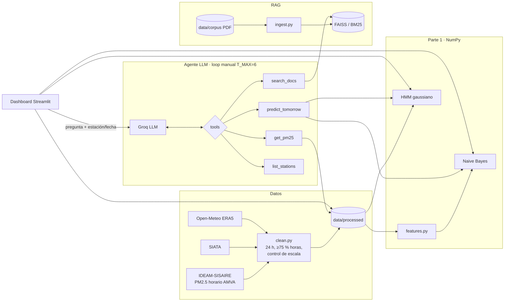

# Agente de calidad del aire del Valle de Aburrá

Proyecto final de **SI3003 – Inteligencia Artificial (EAFIT, 2026-1)**. Le explica a un ciudadano
qué significa el PM2.5 del día en una estación del Valle de Aburrá, qué tan probable es que mañana
empeore y qué hacer, citando normativa y guías oficiales.

> ⚠️ **Herramienta académica.** No es consejo médico ni una declaratoria oficial. Para alertas
> oficiales consulta [SIATA](https://siata.gov.co) y el Área Metropolitana del Valle de Aburrá (AMVA).

**Inicio rápido** (después de la instalación): `streamlit run app.py` y abre http://localhost:8501.

## Componentes
| Parte | Qué hace | Código |
|---|---|---|
| IA clásica | Naive Bayes categórico (clase de mañana) y HMM gaussiano de 3 estados (estado latente y predicción a un paso), escritos a mano en NumPy | `src/models/` |
| Agente LLM | Loop manual con tool calling (`T_MAX = 6`); herramientas `get_pm25`, `predict_tomorrow`, `search_docs` y `list_stations`; RAG con citas `[fuente, p. N]` | `src/agent/`, `src/rag/` |
| Dashboard | Streamlit + Plotly: mapa por categoría ICA, serie con bandas ICA, estado latente del HMM, tarjeta de predicción y chat con traza | `app.py` |

## Arquitectura


## Instalación (Python 3.13, CPU)
```bash
py -3.13 -m venv .venv            # Linux/Mac: python3.13 -m venv .venv
.venv\Scripts\activate            # Linux/Mac: source .venv/bin/activate
pip install -r requirements.txt
copy .env.example .env            # Linux/Mac: cp .env.example .env
```
Edita `.env` y pon tu `GROQ_API_KEY` (se crea gratis en https://console.groq.com → API Keys).
`LLM_MODEL` ya viene configurado con `openai/gpt-oss-120b`; `python -m src.agent.llm` lista otros
modelos del endpoint. Sin clave, todo funciona menos el chat.

En Windows, si la consola muestra errores de codificación (`UnicodeEncodeError`), ejecuta antes
`set PYTHONUTF8=1` (cmd) o `$env:PYTHONUTF8=1` (PowerShell).

## Cómo correr cada parte
El repositorio ya incluye los datos procesados, los modelos entrenados y el índice RAG, así que los
pasos 1 a 3 solo hacen falta para regenerarlos.

| Paso | Comando | Resultado |
|---|---|---|
| 1. Datos | `python -m src.data.download` y luego `python -m src.data.clean` | `data/raw/` (no versionado, ~120 MB) → `data/processed/` |
| 2. Modelos | `python -m src.models.train` | `models/*.json`, `results/metrics_part1.json`, `results/figures/` |
| 3. Índice RAG | `python -m src.rag.ingest` (la primera vez descarga el modelo de embeddings, ~470 MB) | `data/index/` |
| Tests | `python -m pytest -q` | 52 tests |
| Probar el retriever | `python -m src.rag.retriever "límite de PM2.5 en 24 horas"` | fragmentos con fuente y página |
| Agente en consola | `python -m src.agent.loop "¿Cómo está el aire hoy en Itagüí?"` | respuesta y traza de herramientas |
| **Dashboard** | `streamlit run app.py` | http://localhost:8501 |
| Evaluación del agente | `python eval/run_eval.py` (~6 min por las pausas del plan gratuito de Groq) | `eval/results.md`, `eval/traces.json` |

Con `make` instalado: `make data train index test app eval`. Los notebooks `notebooks/01_eda.ipynb` y
`02_parte1_modelos.ipynb` solo leen lo que produce `src/`.

## Datos
- **PM2.5 horario medido** de las estaciones del AMVA, 2020–2025, desde IDEAM-SISAIRE, con relleno
  de huecos usando la ventana de SIATA (jul-2023 a jul-2024).
- **Agregación:** promedio diario de 24 h, solo días con ≥ 75 % de horas válidas (18 de 24); se descartaron 1 922 días-estación.
- **Control de calidad:** en SISAIRE, varias estaciones reportan en 2020–2023 valores varias veces
  mayores que las vecinas (medianas de 60 a 117 µg/m³ frente a ~15). Se descartaron 715 estación-mes
  (404 789 horas) con una regla de consistencia frente a la región y a la propia estación; ver `src/data/clean.py`.
- **Resultado:** 25 estaciones y 28 304 días-estación (`data/processed/pm25_diario.csv`, `estaciones.csv`).
  Clases: normal 27 996 · alerta 307 · crítico 1.
- **Meteorología:** lluvia y viento diarios de Open-Meteo (reanálisis ERA5, **modelado, no medido**),
  en 8 celdas de 0,1° que cubren las estaciones.
- **Clases del proyecto:** `normal` (≤ 37 µg/m³) · `alerta` (38–55) · `critico` (≥ 56). Es una
  simplificación basada en el ICA de la Res. 2254 de 2017; por rangos, coincide con los niveles de
  Prevención y de Alerta o Emergencia de la Tabla 4 de esa resolución, pero **no es una declaratoria oficial**.

Los reportes de descarga y limpieza están en `data/processed/download_report.json` y `clean_report.json`.

## Resultados de la Parte 1 (prueba 2024–2025, entrenado con 2020–2023)
Partición temporal por fecha del día objetivo. Los hiperparámetros del NB (α = 5, prior empírico
suavizado, decisión por argmax) se eligieron con validación de ventana expandible en 2021–2023.

| Modelo | Accuracy | F1 macro | Recall episodios | Precisión episodios | Log-loss |
|---|---|---|---|---|---|
| Persistencia | 0,987 | **0,511** | **0,549** | 0,543 | — |
| Climatología mensual | 0,986 | 0,331 | 0,000 | — | 0,065 |
| **Naive Bayes** | **0,989** | 0,505 | 0,451 | **0,628** | **0,039** |
| HMM (predicción a 1 paso) | 0,986 | 0,331 | 0,000 | — | 0,058 |

"Episodio" = alerta o crítico; el F1 macro incluye las 3 clases. **Lectura honesta:** el NB empata
con la persistencia en F1 macro, es más preciso cuando anuncia un episodio y entrega probabilidades
mucho mejores que la climatología. El HMM separa niveles de fondo (~12, 17 y 25 µg/m³), no
episodios. Detalle en `results/metrics_part1.json` y `notebooks/02_parte1_modelos.ipynb`.

## Evaluación del agente
14 preguntas fijas (`eval/questions.yaml`) calificadas automáticamente con `python eval/run_eval.py`:
**13/14 correctas (93 %)**, 14/14 con las herramientas esperadas y 6/6 con citas verificadas contra los
fragmentos recuperados. El único fallo (niveles de declaratoria) se debe al OCR ilegible de la Tabla 4
de la Res. 2254. Tabla completa y análisis en `eval/results.md`, trazas en `eval/traces.json`.
Correr el script sobrescribe `results.md`, así que la sección de análisis de fallos hay que volver a escribirla a mano.

## Fuentes
Todas consultadas o descargadas el **2026-11-06**.

| Fuente | Uso | URL | Estado |
|---|---|---|---|
| IDEAM – SISAIRE, *Calidad del Aire en Colombia* (datos.gov.co, `g4t8-zkc3`) | PM2.5 horario de las estaciones AMVA, 2020–2025 (fuente principal) | https://www.datos.gov.co/resource/g4t8-zkc3 | OK, 1 046 932 filas |
| SIATA, `Datos_SIATA_Aire_pm25.json` | Relleno de huecos, jul-2023 a jul-2024 | https://siata.gov.co/EntregaData1/Datos_SIATA_Aire_pm25.json | OK (solo ventana de 1 año) |
| Portal de datos abiertos del AMVA | Fuente preferida según el plan | https://datosabiertos.metropol.gov.co/dataset/mediciones-estaciones-calidad-del-aire | **502 Bad Gateway** en todos los intentos |
| Open-Meteo Historical Weather API (ERA5) | Lluvia y viento diarios | https://open-meteo.com/en/docs/historical-weather-api | OK (licencia CC BY 4.0) |
| Corpus normativo y de salud (7 PDF) | RAG | ver `data/corpus/SOURCES.md` | OK; falta el Acuerdo Metropolitano 04 de 2018 (404) |

## Limitaciones
- **Casi no hay días críticos** (1 en seis años) y pocos de alerta (~1 %): el modelo no puede aprender la clase crítico y las métricas de episodios dependen de pocos eventos, sobre todo del episodio de feb–abr de 2024.
- Entre 2020 y 2023 faltan los datos de la mitad de las estaciones por la inconsistencia de escala en SISAIRE; el entrenamiento se apoya en unas 10 estaciones.
- 2020 incluye la cuarentena por COVID-19, con emisiones atípicas.
- La meteorología es reanálisis de baja resolución y del día *t*; no hay pronóstico del día siguiente.
- El POECA del corpus es el Acuerdo Metropolitano 15 (versión SICLAS), no el Acuerdo 04 de 2018 vigente. La Res. 2254 viene de una copia escaneada con OCR, con algo de ruido en el texto.
- El agente depende de un LLM externo (Groq, plan gratuito): hay límite de tokens por minuto y las respuestas pueden variar entre corridas.
- Los datos llegan hasta el 2025-12-31: "hoy" en la app es la fecha más reciente disponible o la que elija el usuario.

## Informe
`docs/informe.pdf` (4 páginas) se genera desde `docs/informe.tex`: `cd docs` y luego `pdflatex informe.tex`
(dos veces). La figura se toma de `results/figures/`. Hay una versión en Markdown en `docs/informe.md`.

## Uso de IA generativa
Ver `docs/declaracion_ia.md`.
